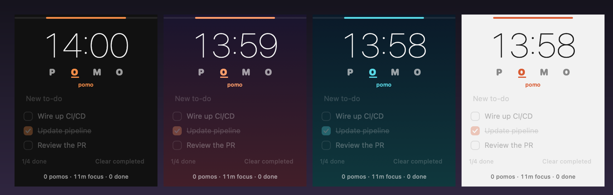

# Pomo

A minimal, always-on-top pomodoro with a checklist. macOS app, plus a Windows overlay in [`windows/`](windows).



## Use

- Click the clock to start, pause or resume. Option-click restarts.
- Set a length by typing on the clock (⏎), with the ▲▼ chevrons, or with ↑ / ↓ while the clock is focused.
- **POMO** under the clock picks a length: **P** 1 hr · **O** 25 min · **M** 15 min · **O** 5 min.
- Focus ends → 5 min break → next focus, when *Automatic rhythm* is on.
  The strip on top drains toward the centre as time runs out (green on breaks).
- Type a to-do and press ⏎. Click a row to tick it, × to delete, *Clear completed* to tidy up.
- Click the footer line (`1/4 done`) for today's tally: `2 pomos · 50m focus · 3 done`.
- Pause keeps its place, even after quitting.

## Run it

### macOS

Needs macOS 12+ and Xcode Command Line Tools (`xcode-select --install`).

```sh
git clone https://github.com/freddyfernandes/pomo && cd pomo
./build.sh           # builds build/Pomo.app and opens it
./build.sh --pin     # optional: start at login, countdown in the menu bar
./build.sh --unpin   # undo
```

The menu-bar wordmark opens the menu: start/pause, automatic rhythm, **Theme**, reset stats, show, quit.
Settings live in `defaults` domain `local.pomo`; `defaults delete local.pomo` resets everything.

### Windows

A native overlay in C# with Windows Forms — nothing to install, the compiler ships with Windows.

```powershell
git clone https://github.com/freddyfernandes/pomo && cd pomo\windows
powershell -ExecutionPolicy Bypass -File build.ps1   # builds Pomo.exe and starts it
```

Right-click the card or the tray icon for the menu (themes, rhythm, reset stats, quit). Space starts and pauses,
↑/↓ nudge the length, ←/→ jump between the favourites, Esc quits. Settings live in `%APPDATA%\Pomo`.

## Themes

Menu bar (or tray) → **Theme**: Ember, Slate, Forest, Sakura, Paper (light), and the dual-tone
**Dusk**, **Moss**, **Lagoon** — the card fades from one tone into another.
**Custom…** has six colour wells: top, bottom, card, accent, break, text.

## Develop

```sh
swift -module-cache-path ./.cache selftest.swift   # headless checks: to-dos, timer, strip, stats, themes
```

## License

© 2026 Freddy Fernandes. All rights reserved. Not open source — see [LICENSE](LICENSE),
which also covers website deployment, distribution and commercial use.
