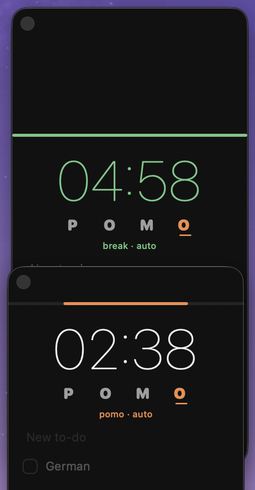

# Pomo

A tiny always-on-top pomodoro + checklist for macOS. One Swift file, AppKit only, no dependencies.



## What it does

- **Clock** top-right, above other windows. Click it to start / pause / resume; ⌥-click restarts.
- **POMO** under the clock — each letter is a timer length: **P** 1 hr · **O** 25 min · **M** 15 min · **O** 5 min.
  The same word lives in the menu bar; click a letter there, or ⌄ for the menu (start/pause, pin, show, quit).
- **Automatic rhythm** (optional): focus ends → 5 min break starts → next focus starts, until you pause.
- **Orange strip** across the top drains from both ends toward the centre as time runs out (green on a break).
- **Checklist**: borderless field at the bottom — type, press ⏎. Tick a box to finish; × on hover deletes it;
  *Clear completed* removes everything ticked. Everything persists between launches.
- **Pause saves state**: the clock freezes at e.g. `24:12` and resumes there, even after quitting.

## Run it locally

Requires macOS 12+ and Xcode Command Line Tools (`xcode-select --install`).

```sh
git clone <this repo> pomo && cd pomo
./build.sh          # compiles Pomo.swift and opens the app (menu bar items: left-click = show/hide, right-click = menu)
./build.sh --pin     # optional: also start Pomo at login, with the live countdown in the menu bar
./build.sh --unpin   # undo that
```

The app builds into `build/Pomo.app` inside the repo. Nothing is installed system-wide.
To keep it on the home screen, drag `build/Pomo.app` to the Dock or Launchpad (it runs as a menu-bar app, no Dock icon).

Settings live in `defaults` domain `local.pomo` (`defaults read local.pomo`). Remove everything with `defaults delete local.pomo`.

## Develop

```sh
swift selftest.swift   # headless checks: to-dos, timer rhythm, time-left strip (19 checks)
```

Single source file `Pomo.swift` (~900 lines). Tags `v1-loved` / `v2-centre-drain` mark earlier looks; `git log` is the changelog.

## License

(c) 2026 Freddy Fernandes. All rights reserved — proprietary, not open source. See [LICENSE](LICENSE).
